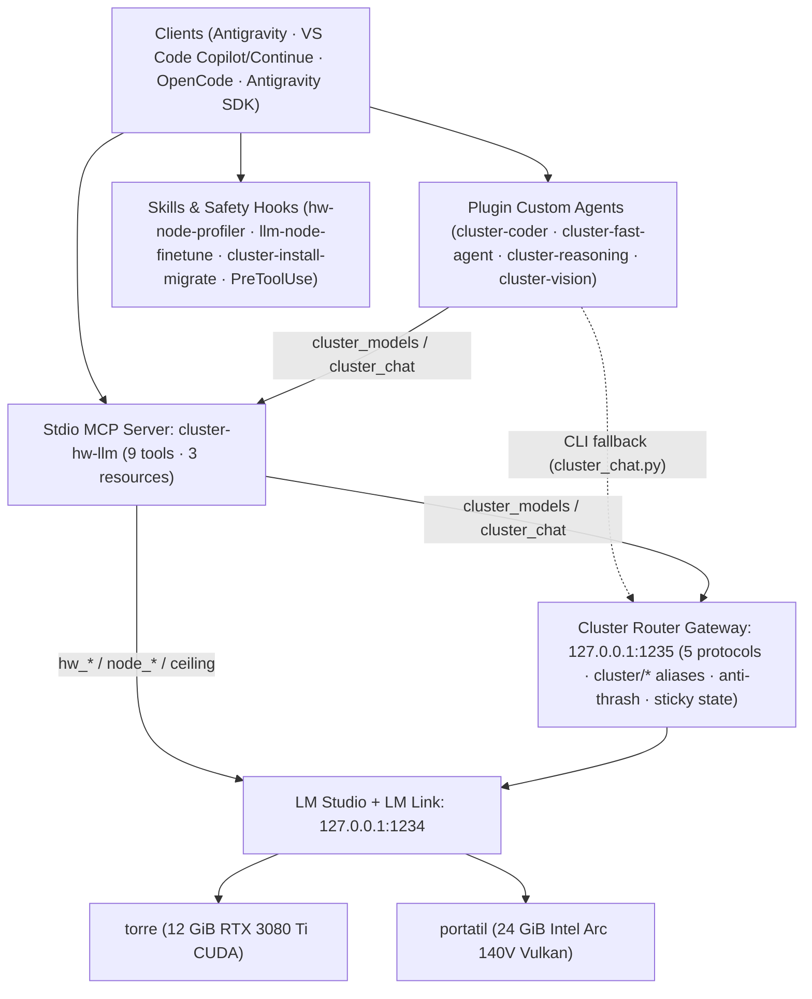

# Agent Collaboration & Local Cluster Architecture

This guide explains how Antigravity, IDE agents, custom plugin subagents, skills, lifecycle hooks, the `cluster-hw-llm` MCP server, and the Cluster Router Gateway (`:1235`) combine to drive your dual-node local GPU pool (`torre` + `portatil`).

---

## 1. End-to-End Architecture

Antigravity's native UI model dropdown only lists Google-managed cloud models and does not support custom OpenAI-compatible BYOK endpoints directly. Instead, your local cluster integrates cleanly as **custom plugin agents + MCP tools + the 5-protocol local gateway**:



---

## 2. How the Layers Divide Work and Collaborate

| Layer | What It Owns | How It Collaborates |
|---|---|---|
| **Orchestrator (Antigravity / IDE)** | Planning, reading/editing workspace files, running tests, and terminal verification | Inspects code/errors, picks the right specialist agent or MCP tool, applies approved edits, and verifies results |
| **Plugin Custom Agents (4)** | Specialized local-cluster delegation (`cluster-coder`, `cluster-fast-agent`, `cluster-reasoning`, `cluster-vision`) | Gather focused file context (`read_file`), delegate generation to `cluster/*` via `cluster_chat`, and keep follow-ups stateful via `previous_response_id` |
| **Skills (3)** | Domain runbooks (`hw-node-profiler`, `llm-node-finetune`, `cluster-install-migrate`) | Teach the orchestrator two-phase hardware-first discipline, ceiling math, A/B sweep gates, and cross-OS sync |
| **Safety Hooks (`hooks.json`)** | `SessionStart` + `PreToolUse` (`run_command` guard) | Inject active node/endpoint context on session start and block destructive LM Studio default overwrites or un-scoped `lms unload --all` |
| **MCP Server (`cluster-hw-llm`)** | 9 tools + 3 resources across HW, tuning, and gateway chat | Exposes `hw_node_profile`, `hw_gpu_telemetry`, `hw_event_log_check`, `llm_compute_ceiling`, `node_llm_status`, `node_best_configs`, `node_llm_control`, `cluster_models`, and `cluster_chat` |
| **Cluster Router Gateway (`:1235`)** | 5 API protocols, `cluster/*` virtual routing, anti-thrash, sticky response state | Resolves virtual aliases to live `torre` / `portatil` models, fails over automatically, and pins stateful `previous_response_id` turns to the holding node |

---

## 3. Dual-Node Home Mode vs. Laptop Failover Mode

Because every agent, IDE config, and SDK script targets **virtual `cluster/*` aliases** rather than hardcoding `torre`, `t-*`, or `p-*` IDs, the exact same setup adapts automatically in both locations:

- **At Home (`torre` + `portatil` connected over LM Link):**
  - Heavy MoE coding and `32K` vision (`cluster/code`, `cluster/code-heavy`, `cluster/agent-heavy`, `cluster/vision-heavy`) route to `portatil`'s `24 GiB` unified memory (`30B-A3B` / `26B+MTP3`).
  - Low-latency coding, fast subagents, reasoning, math, and fast vision (`cluster/code-fast`, `cluster/fast-agent`, `cluster/reasoning`, `cluster/math`, `cluster/vision`) route to `torre`'s `RTX 3080 Ti` (`71–130 tok/s`).
  - **Anti-thrash guardrail:** When `torre` holds a heavy `12B–15B` model in its `12 GiB` VRAM, `cluster/autocomplete` and `cluster/embed` automatically divert to `portatil` so LM Studio never evicts the active model.
- **Away from Home (`portatil` alone, `torre` offline):**
  - Every `cluster/*` alias automatically fails over to `portatil`'s local `24 GiB` Intel Arc 140V models (`p-code-moe`, `p-agent-moe`, `p-agent-moe-alt`, `p-battery-chat`, `p-autocomplete-tab`, `p-embed-index`) with zero config changes.

---

## 4. Common Multi-Agent Collaboration Workflows

1. **Coding + Review (`cluster-coder` + Orchestrator):**
   - Antigravity reads target files and tests, delegates implementation ideas or refactors to `cluster-coder` (`cluster/code`, `cluster/code-fast`, or `cluster/code-heavy`), applies the reviewed patch in the workspace, and runs the test suite.
2. **Fast Commit / Triage (`cluster-fast-agent`):**
   - `cluster-fast-agent` inspects `git diff` / `git status` and calls `cluster/fast-agent` (`t-fast-agent` at `~127 tok/s` at home, `p-battery-chat` away) for rapid summaries, commit messages, or doc drafts.
3. **Deep Debugging & Math Verification (`cluster-reasoning`):**
   - `cluster-reasoning` routes tough race conditions, algorithmic edge cases, or formal derivations to `cluster/reasoning` (with `reasoning: "high"`) or `cluster/math`, returning step-by-step checks for the orchestrator to test.
4. **Multimodal & Long-Context Visual Inspection (`cluster-vision`):**
   - `cluster-vision` checks live routes via `cluster_models` and delegates visual/UI or `32K` context prompts to `cluster/vision` or `cluster/vision-heavy`.
5. **Hardware-First Tuning (`hw-node-profiler` -> `llm-node-finetune`):**
   - Before tuning a node, the orchestrator runs `hw_node_profile` + `hw_event_log_check` (`0` `WHEA 18/19`, `0` `nvlddmkm 153`), computes theoretical limits via `llm_compute_ceiling`, inspects `node_best_configs`, and verifies cold loads with prefix-scoped `node_llm_control` without overwriting persisted LM Studio defaults.

---

## 5. Keeping `torre` and `portatil` in Sync (Windows & WSL)

Run the one-command plugin/client sync on each machine after pulling updates (works across both Windows and WSL):

- **Ubuntu WSL / Linux:**
  ```bash
  git pull && bash install.sh --os auto --targets agy --scope user
  ```
- **Windows PowerShell:**
  ```powershell
  git pull
  powershell.exe -NoProfile -ExecutionPolicy Bypass -File .\install.ps1 -Os auto -Targets agy -Scope user
  ```
