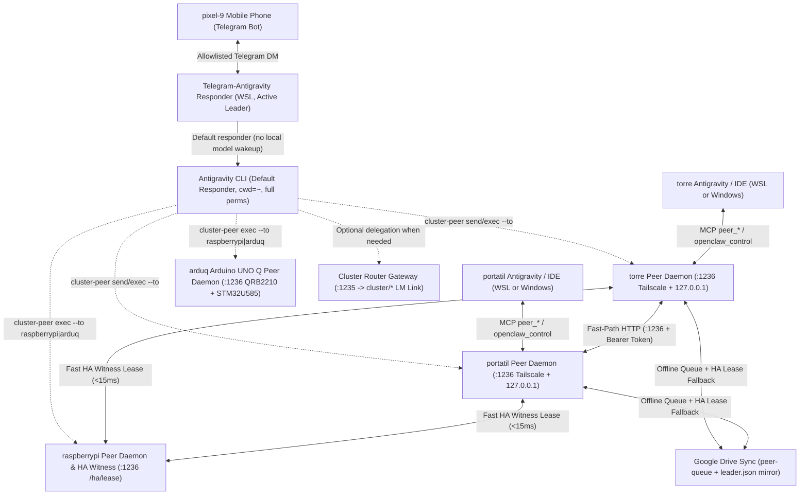

# Bidirectional Peer Order Bridge & OpenClaw Telegram HA (5-Device Tailscale Mesh)

Send autonomous tasks and shell commands across **`torre` (PC)**, **`portatil` (Laptop)**, **`raspberrypi` (Raspberry Pi 2 Model B HA Witness)**, **`arduq` (Arduino UNO Q Dual-Processor QRB2210 Linux MPU + STM32U585 MCU)**, and **`pixel-9` (Mobile Phone via Telegram Bot)** without `409 Conflict` split-brain errors.

---

## 1. Architecture



---

## 2. How Cross-OS & Bidirectional Control Works

1. **Fast-Path Over Tailscale (`:1236`) + Google Drive Offline Queue:**
   - Each machine runs `tools/peer/peer_daemon.py` bound strictly to `127.0.0.1` + its Tailscale IP (never `0.0.0.0`), protected by a 256-bit `Bearer` token stored in gitignored `cluster.local.json` and synced to `<sync_dir>/peer.token`.
   - When the sibling machine is online, orders travel over Tailscale in `<20 ms`.
   - When the sibling machine is asleep or offline, `peer_ctl.py` / `peer_send_order` automatically drops the task into `<sync_dir>/peer-queue/to_<node>/`, and the sibling daemon runs it as soon as it wakes up.
2. **WSL, Windows, or Crossed Execution (`--os auto | wsl | windows`):**
   - Because WSL2 uses `networkingMode=mirrored`, Windows and WSL on each machine share `127.0.0.1` and the Tailscale IP.
   - `target_os="wsl"` executes `~/.gemini/bin/agy -p ... --mode auto --dangerously-skip-permissions --output-format json` (or `bash -lc`).
   - `target_os="windows"` runs `powershell.exe -NoProfile -Command ...` with `stdin=subprocess.DEVNULL` (for `exec`) or routes an `agy` task targeting Windows PowerShell.
3. **Antigravity-First Telegram Bridge in WSL + Active-Standby HA:**
   - By default (`peer.openclaw.responder = "antigravity"`), the active leader runs `tools/peer/telegram_agy_daemon.py` in **WSL**, polling your Telegram bot for allowlisted DMs and routing messages to Antigravity (`~/.gemini/bin/agy -p ... --dangerously-skip-permissions --output-format json`) with `cwd=~` (project-independent) and persistent per-chat `conversation_id`.
   - Local LM Studio models (`:1234` / `:1235`) stay idle unless Antigravity explicitly delegates a task to cluster tools/subagents. (You can switch back to the OpenClaw gateway anytime by setting `peer.openclaw.responder = "openclaw"` in gitignored `cluster.local.json`; OpenClaw itself remains wrapped at `~/.local/bin/openclaw` pinned to Node `v24+`.)
   - To copy Telegram/provider/gateway secrets directly from `torre` to `portatil` over authenticated Tailscale `:1236` (keeping them out of Git and Google Drive), run:
     ```bash
     python3 tools/peer/openclaw_ctl.py sync-secrets --to portatil
     ```
   - Only **one** machine holds `<sync_dir>/openclaw-ha/leader.json` and polls Telegram `getUpdates` at any time:
     - **`torre`** is primary when online.
     - **`portatil`** promotes itself automatically if `torre` fails 3 consecutive probes and the 30s lease expires.
     - **Manual Takeover:** Either PC or Laptop can run `openclaw_ctl.py takeover` (or MCP `openclaw_control(action="takeover")`) to cleanly fence the sibling over `:1236` and assume Telegram bot leadership immediately.

---

## 3. CLI & MCP Usage

### From Antigravity / VS Code / Continue / OpenCode (MCP Tools)
- `peer_status()` — Check `torre` and `portatil` `:1236` health, `agy` availability, queued jobs, and OpenClaw HA lease.
- `peer_send_order(node="portatil", prompt="Pull latest main and run doctor", target_os="wsl", mode="auto", wait_s=120)`
- `peer_order_status(job_id="...")` — Check async job output and `conversation_id` for multi-turn follow-ups.
- `peer_exec(node="torre", command="Get-Service Tailscale", target_os="windows")` — Run PowerShell or bash directly on either node.
- `openclaw_control(action="takeover")` / `openclaw_control(action="status")` / `openclaw_control(action="telegram_reply", message="...")`

### From Terminal (`peer_ctl.py` & `openclaw_ctl.py`)
```bash
# Check peer & OpenClaw status
python3 tools/peer/peer_ctl.py status
python3 tools/peer/openclaw_ctl.py status

# Send an Antigravity task from PC -> Laptop (WSL) or Laptop -> PC (Windows)
python3 tools/peer/peer_ctl.py send --to portatil --os wsl --wait 120 "Run git pull and doctor"
python3 tools/peer/peer_ctl.py exec --to torre --os windows "nvidia-smi"

# Deploy or update the zero-dependency peer daemon on Linux edge nodes (raspberrypi & arduq)
python3 tools/peer/peer_ctl.py deploy-edge --to all
python3 tools/peer/peer_ctl.py exec --to raspberrypi "uname -a && uptime"
python3 tools/peer/peer_ctl.py exec --to arduq "uname -a && lscpu"

# Transfer OpenClaw Telegram leadership to the current machine
python3 tools/peer/openclaw_ctl.py takeover
```

---

## 4. Setup on Both Machines

1. **On `torre` (Primary PC):**
   ```bash
   bash install.sh --node torre --os auto --targets agy,opencode,vscode --serving --peer --openclaw --doctor
   ```
2. **On `portatil` (Standby Laptop):**
   ```bash
   git pull && bash install.sh --node portatil --os auto --targets agy,opencode,vscode --serving --peer --openclaw --doctor
   ```
   *(On Windows PowerShell, `.\install.ps1 -Node portatil -Os auto -Targets agy,opencode,vscode -Serving -Peer -OpenClaw -Doctor` bridges into WSL automatically.)*
