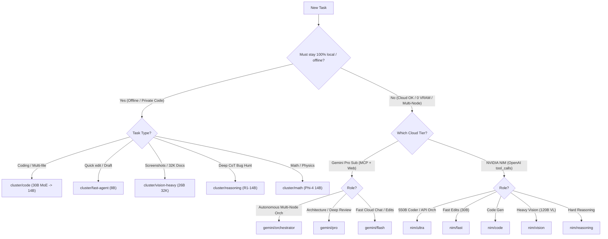

# Cluster Mode User Guide (`torre` + `portatil` + `raspberrypi` + `arduq` + `pixel-9`)

Your entire setup — **PC (`torre`)**, **Laptop (`portatil`)**, **Windows 11 + Ubuntu WSL2**, **OpenCode**, **VS Code (Continue & Copilot Chat)**, **Antigravity (`agy`)**, **Telegram (`pixel-9`)**, and your **edge Linux nodes (`raspberrypi`, `arduq`)** — runs on **one unified 13-model Cluster Mode** behind the local **Cluster Router Gateway (`http://127.0.0.1:1235/v1`)**.

Instead of picking raw per-machine models (`t-*`, `p-*`) or duplicating cloud providers, you pick by **role** across **3 tiers**:
1. **Tier 1 (`cluster/*`) — Local Dual-GPU:** \$0, 100% private/offline; automatically routes to the best GPU at home and fails over seamlessly when you travel with only the laptop.
2. **Tier 2 (`nim/*`) — NVIDIA NIM Cloud:** 0 local VRAM, OpenAI-native `tool_calls` for OpenCode/Continue edits and `cluster_orchestrate`.
3. **Tier 3 (`gemini/*`) — Gemini Pro Subscription (`agy` OAuth bridge):** \$0 extra API billing, `1M` context, powered by your Gemini Pro subscription (`gemini/orchestrator`, `gemini/pro`, `gemini/flash`) with autonomous edit permissions (`--mode auto --dangerously-skip-permissions`).

---

## 1. Your 13-Model Cluster Menu

Every IDE and chat client shows the **same 13 curated models** (`5` local dual-GPU + `5` NVIDIA NIM cloud + `3` Gemini Pro subscription):

| # | Model Alias | Role | Backend |
| :---: | :--- | :--- | :--- |
| 1 | `cluster/code` | Default local coding & multi-file agent | Local Dual-GPU (`30B-A3B MoE -> 14B` auto-failover) |
| 2 | `cluster/fast-agent` | Ultra-fast local edits, drafts & triage | Local Dual-GPU (`8B 130 tok/s -> 4B`) |
| 3 | `cluster/vision-heavy` | Local multimodal vision & `32K` context | Local Dual-GPU (`26B 32K -> 12B`) |
| 4 | `cluster/reasoning` | Local chain-of-thought reasoning | Local Dual-GPU (`R1-14B -> 30B MoE`) |
| 5 | `cluster/math` | Local math & physics proofs | Local Dual-GPU (`Phi-4 14B -> 30B MoE`) |
| 6 | `nim/ultra` | Flagship 550B cloud architect & API orchestrator | NVIDIA NIM Cloud (`Nemotron-3 Ultra 550B`, `0` VRAM) |
| 7 | `nim/fast` | Ultra-fast 30B cloud agent & edits | NVIDIA NIM Cloud (`Nemotron-3.5 Lightning 30B`, `0` VRAM) |
| 8 | `nim/code` | Dedicated fast cloud coder | NVIDIA NIM Cloud (`Poolside Laguna-XS 2.1`, `0` VRAM) |
| 9 | `nim/vision` | 120B cloud multimodal vision | NVIDIA NIM Cloud (`Nemotron-3.5 Super-VL 120B`, `0` VRAM) |
| 10 | `nim/reasoning` | Cloud chain-of-thought reasoning | NVIDIA NIM Cloud (`Nemotron-3 30B Reasoning`, `0` VRAM) |
| 11 | `gemini/orchestrator` | Flagship autonomous cloud orchestrator (MCP + web + edits) | Gemini Pro Subscription (`gemini-pro-orchestrator-neon`, `0` VRAM) |
| 12 | `gemini/pro` | Flagship cloud architect, code review & edits | Gemini Pro Subscription (`gemini-4-neon-medium`, `0` VRAM) |
| 13 | `gemini/flash` | Fast low-latency Gemini Pro cloud assistant & edits | Gemini Pro Subscription (`gemini-3.8-flash-medium`, `0` VRAM) |

> [!NOTE]
> **How OpenCode & Continue display these:**
> - **OpenCode:** Uses one `cluster` provider (`Cluster (Local + NIM + Gemini Pro)`), so the cloud entries appear as `cluster/nim/ultra`, `cluster/nim/fast`, ..., `cluster/gemini/orchestrator`, `cluster/gemini/pro`, `cluster/gemini/flash` alongside `cluster/code`, `cluster/fast-agent`, etc. Raw `lmstudio`, `ollama`, `opencode/*-free`, `nvidia`, and `sglang` providers are hidden automatically.
> - **Gemini Pro runtime (`gemini/*`):** Routes behind `:1235` to your OAuth-authenticated Antigravity CLI (`~/.gemini/bin/agy`) with autonomous permissions (`--mode auto --dangerously-skip-permissions`), web search, and direct access to all `cluster-hw-llm` MCP tools. Note: OpenCode's own OpenAI `tool_calls` loop is driven directly by `cluster/*` and `nim/*`, while `gemini/orchestrator` runs Antigravity's native autonomous agent loop inside `agy` (and can also be invoked via MCP `cluster_orchestrate(model="gemini/orchestrator")`).
> - **Continue (VS Code):** Also configures **2 silent background IDE helpers**: `cluster/autocomplete` (Tab FIM autocomplete) and `cluster/embed` (codebase `@codebase` embeddings).
> - **Terminal / MCP power-users:** Extra gateway aliases (`cluster/code-fast`, `cluster/code-heavy`, `cluster/vision`, `nim/mistral-large`, `nim/kimi`, `nim/step`, etc.) still work directly on `:1235` and `cluster_chat` even though they are hidden from UI pickers to keep menus clutter-free.

### Quick Model Picker Decision Flow



---

## 2. Who Is the Orchestrator? (Per Working Surface)

An **orchestrator** is the model/agent in charge of reading your files, planning multi-step actions, calling MCP tools (`cluster-hw-llm`), running shell/peer commands, and optionally delegating sub-tasks. Depending on which tool you open, **who orchestrates** works differently:

| Surface / Tool | Who Orchestrates | Tools It Controls | Wakes Local GPUs? |
| :--- | :--- | :--- | :--- |
| **Antigravity IDE / CLI (`agy`)** | **Antigravity Cloud Agent** (or **`cluster-orchestrator` subagent** via `gemini/orchestrator` or `nim/ultra`) | Native file/terminal/web/browser tools + **15 `cluster-hw-llm` MCP tools** + **5 plugin subagents** | **No** — local `cluster/*` GPUs stay asleep unless you explicitly delegate |
| **OpenCode (Windows & WSL)** | **Whichever model you select** in `/models` (defaults to **`cluster/code`**; switch to **`cluster/nim/ultra`** for OpenAI `tool_calls` or **`cluster/gemini/orchestrator`** / **`cluster/gemini/pro`** for Gemini Pro subscription planning & `agy` execution) | OpenCode file/bash/edit tools (for `cluster/*` & `nim/*`) + **15 `cluster-hw-llm` MCP tools** (`cluster_orchestrate` can escalate to `gemini/orchestrator`!) | Only if you select one of the 5 local `cluster/*` models (or call `cluster_chat`) |
| **VS Code (Continue / Copilot BYOK)** | **Your selected model** in Continue or Copilot Chat (`cluster/code`, `nim/ultra`, or `gemini/orchestrator` / `gemini/pro` / `gemini/flash`) | IDE edit/codebase tools + **`cluster-hw-llm` MCP tools** (+ silent FIM/Embed in Continue) | Only if you select a local model (or trigger Tab autocomplete / `@codebase` embed) |
| **Telegram Bot (`pixel-9` Phone)** | **Antigravity CLI (`agy -p`)** on the active HA leader (`torre` primary, `portatil` automatic standby via `raspberrypi` witness) | Full autonomous CLI (`cwd=~`) + **15 MCP tools** + `cluster-peer` across all 4 nodes | **No** — stays in cloud unless you explicitly ask to invoke a local `cluster/*` model |
| **Terminal / MCP Orchestrator (`cluster-chat --orchestrate` or MCP `cluster_orchestrate`)** | **`gemini/orchestrator`** (Gemini Pro subscription, full `agy` + web + MCP runtime) **or** **`nim/ultra` / `nim/fast`** (NVIDIA NIM OpenAI `tool_calls` loop, default) | Full multi-node planning & execution across `torre`, `portatil`, `raspberrypi`, and `arduq` (`peer_status`, `peer_exec`, `peer_send_order`, `cluster_models`, `cluster_chat`, `hw_node_profile`, etc.) | **No** — zero local VRAM unless the orchestrator itself delegates a sub-task via `cluster_chat` |

> [!TIP]
> **Best Rule of Thumb for Orchestration:**
> - **Top-Tier Cloud Orchestrator (Subscription, \$0 extra cost, Web + MCP + Cross-Node):** Use **`gemini/orchestrator`** (`cluster-chat --orchestrate --model gemini/orchestrator` or `cluster_orchestrate(model="gemini/orchestrator")`).
> - **Fast Native OpenAI IDE Tool-Calling (Inside OpenCode / Continue):** Use **`nim/ultra`** or **`nim/fast`** (cloud, 0 VRAM) or **`cluster/code`** (local dual-GPU).
> - **Any OpenCode / Continue Model Can Escalate to Gemini Pro:** Because `cluster-hw-llm` MCP is enabled in OpenCode and Continue, even `cluster/code` or `nim/fast` can invoke `cluster_orchestrate(model="gemini/orchestrator", prompt="...")` when it needs flagship cloud orchestration!

---

## 3. Working Modes & Exact Local vs. Cloud Resources Used

### Mode A — Home Dual-Node Mode (`torre` + `portatil` + `raspberrypi` + `arduq` Online)
At home over Tailscale + LM Link (`:1234` / `:1236`), workloads split automatically by GPU strength:
- **On `portatil` (`Intel Arc 140V 24 GiB` unified memory):** Serves `cluster/code` (`p-code-moe`, 30B-A3B) and `cluster/vision-heavy` (`p-agent-moe`, 26B 32K).
- **On `torre` (`RTX 3080 Ti 12 GiB` CUDA):** Serves `cluster/fast-agent` (`t-fast-agent`, ~127 tok/s), `cluster/reasoning` (`t-deep-reasoning`), and `cluster/math` (`t-math-physics`).
- **Anti-Thrash Protection:** Whenever `torre` holds a 12B–14B model loaded in its 12 GiB VRAM, Continue's `cluster/autocomplete` (Tab FIM) and `cluster/embed` automatically divert to `portatil` so LM Studio never evicts `torre`'s active model.
- **Cloud Models (`nim/*` + `gemini/*`):** Always run in cloud (`integrate.api.nvidia.com` for NIM; OAuth `agy` subscription for Gemini Pro) with **`0` VRAM** on both GPUs.
- **Telegram HA (`pixel-9`):** **`torre`** holds the active leader lease on `raspberrypi:1236`; **`portatil`** runs a quiet `openclaw-sentinel` standby watcher.

### Mode B — Away / Laptop-Only Mode (`portatil` Away, `torre` Offline)
Take your laptop anywhere — zero configuration edits needed:
- **Local Models (`cluster/*`):** Every one of `cluster/code`, `cluster/fast-agent`, `cluster/vision-heavy`, `cluster/reasoning`, and `cluster/math` **automatically fails over** to `portatil`'s 24 GiB local models (`p-code-moe`, `p-battery-chat`, `p-agent-moe`, `p-agent-moe-alt`), alongside local `p-autocomplete-tab` and `text-embedding-p-embed-index`.
- **Cloud Models (`nim/*` + `gemini/*`):** All 8 cloud models (`5` NIM + `3` Gemini Pro) keep working normally over any Wi-Fi/hotspot (`0` VRAM, battery-friendly).
- **Telegram HA Failover:** If `torre` goes offline, `portatil`'s sentinel waits 3 missed health probes + 30s lease TTL on the `raspberrypi` witness (or Drive fallback) and promotes `portatil` to active Telegram leader automatically without `409 Conflict` errors.
- **Offline Peer Queue:** Any `cluster-peer send` / `exec` targeting `torre` drops an HMAC-SHA256 signed job into `<sync_dir>/peer-queue/to_torre/`, which `torre` executes when back online.

### Mode C — Zero-VRAM / Gaming / Battery Mode
When gaming, rendering on `torre`, or maximizing laptop battery life on `portatil`:
- **Use:** Any `gemini/*` (`gemini/orchestrator`, `gemini/pro`, `gemini/flash`) or `nim/*` (`nim/ultra`, `nim/fast`, `nim/code`, `nim/vision`, `nim/reasoning`) model in OpenCode / VS Code / `cluster-chat`, plus Antigravity IDE / Telegram defaults.
- **Local GPUs Used:** **`0 MiB` VRAM / `0%` GPU compute** — local LM Studio models remain idle.

### Mode D — 100% Offline / Privacy-Strict Mode
When working without internet or on sensitive local-only code/data:
- **Use:** Only the **5 local `cluster/*` models** (`cluster/code`, `cluster/fast-agent`, `cluster/vision-heavy`, `cluster/reasoning`, `cluster/math`) + `cluster/autocomplete` + `cluster/embed` + local `cluster-peer` over LAN/Tailscale.
- **Cloud Resources Used:** **None** — zero prompts leave your machines.

### Mode E — 5-Device Tailscale Mesh Mode
| Node | Hardware | Role in Cluster | How to Target It |
| :--- | :--- | :--- | :--- |
| **`torre`** | Windows 11 + WSL2 (`Ryzen 9 5950X`, `RTX 3080 Ti 12 GiB`) | Fast CUDA LLM node + Primary Telegram Leader | `cluster-peer exec/send --to torre --os wsl\|windows` |
| **`portatil`** | Windows 11 + WSL2 (`Core Ultra 7 258V`, `Arc 140V 24 GiB`) | High-memory 30B MoE LLM node + Standby Telegram Leader | `cluster-peer exec/send --to portatil --os wsl\|windows` |
| **`raspberrypi`** | Raspberry Pi 2 Model B (`armv7l` Linux) | Always-on `<15 ms` HA Lease Witness (`/ha/lease`) + Edge node | `cluster-peer exec --to raspberrypi "<cmd>"` |
| **`arduq`** | Arduino UNO Q (`QRB2210 aarch64` Linux MPU + `STM32U585` MCU) | Dual-processor Linux + MCU Edge node | `cluster-peer exec --to arduq "<cmd>"` |
| **`pixel-9`** | Android 17 Phone | Mobile operator via allowlisted Telegram Bot | Send messages / `/status` / `/login` / `/cancel` / `/takeover` |

---

## 4. Daily Usage Examples

### OpenCode (WSL or Windows Terminal / Desktop App)
- Open interactive UI (`opencode`), press `/models`, and choose any of the 13 models (`cluster/code`, `cluster/nim/ultra`, or `cluster/gemini/orchestrator` / `cluster/gemini/pro` / `cluster/gemini/flash`).
- Run a one-shot task from terminal using Gemini Pro or NIM Ultra:
  ```bash
  opencode run -m cluster/gemini/pro "Review this diff for subtle concurrency edge cases"
  opencode run -m cluster/nim/ultra "Audit recent changes and check cluster status"
  ```
- Refresh models immediately after config changes: `opencode reload`.

### VS Code (`Continue` & Copilot Chat BYOK)
- **Continue:** Open the Continue sidebar -> pick `Cluster Code` (local), `NIM Ultra` / `NIM Fast` (cloud tool-calling), `Gemini Pro Orchestrator` / `Gemini Pro` / `Gemini Flash` (Gemini Pro subscription), or `NIM Vision` (screenshots). Tab autocomplete (`cluster/autocomplete`) and `@codebase` (`cluster/embed`) work automatically.
- **Copilot Chat BYOK:** Click the model picker -> **`Local Cluster (LM Link)`** -> choose any of the 13 curated models (`cluster/*`, `nim/*`, or `gemini/*`). All 15 `cluster-hw-llm` MCP tools are pre-registered in VS Code.

### Antigravity IDE (`@` Subagents & MCP Tools)
- Normal turns stay in Antigravity cloud (`0` local GPU wakeup).
- Explicitly delegate when helpful:
  - `@cluster-orchestrator`: Multi-step / multi-node tasks driven autonomously via **`gemini/orchestrator`** or **`nim/ultra`** (`cluster_orchestrate` MCP tool).
  - `@cluster-coder`: Local `cluster/code` (or cloud `nim/code`) code generation & refactoring.
  - `@cluster-fast-agent`: Quick summaries, commit messages, or lightweight drafts (`cluster/fast-agent`).
  - `@cluster-reasoning`: Deep debugging & math (`cluster/reasoning` / `cluster/math`).
  - `@cluster-vision`: Screenshot & diagram analysis (`cluster/vision-heavy` / `nim/vision`).

### Telegram Bot (From Your `pixel-9` Phone)
- Normal message -> Runs autonomously via Antigravity CLI on the active leader (`torre` or `portatil`) from `cwd=~`.
- `/status` -> Shows active leader, session ID, and online status of `torre`, `portatil`, `raspberrypi`, and `arduq`.
- `/new` -> Starts a fresh Antigravity conversation thread.
- `/cancel` -> Aborts an in-flight turn immediately without blocking other commands.
- `/takeover` -> Cleanly switches active Telegram leadership between `torre` and `portatil`.
- `/login` -> Refreshes Antigravity CLI OAuth interactively right from Telegram if a session ever expires.

### Global `PATH` Commands (Usable in Any Directory)
```bash
cluster-gateway status                      # See all cluster/* + nim/* + gemini/* routes and loaded models
cluster-chat --model gemini/flash "Hello"   # Quick Gemini Pro subscription turn via :1235
cluster-chat --model nim/fast "Hello"       # Quick cloud NIM turn via :1235
cluster-chat --orchestrate --model gemini/orchestrator "Check uptime on torre, portatil, raspberrypi, and arduq"
cluster-chat --orchestrate --model nim/ultra "Check uptime on torre, portatil, raspberrypi, and arduq"
cluster-peer status                         # Check all 4 Tailscale daemon nodes + HA lease
cluster-peer exec --to arduq "uname -a"     # Run shell on Arduino UNO Q
cluster-telegram status                     # Inspect Active-Standby Telegram HA state
cluster-doctor --all --check-privacy        # Run full self-test + secret leak guard
```

---

## 5. Keeping PC & Laptop Synchronized

Whenever updating the toolkit or keys:
```bash
# On PC (torre) after pulling or editing:
python3 scripts/install.py --os windows,wsl --targets all --scope user
python3 scripts/setup_clients.py --os windows,wsl --clients all
python3 tools/peer/openclaw_ctl.py sync-secrets --to portatil   # Syncs Telegram + NVIDIA key over Tailscale
python3 tools/gateway/gateway_ctl.py restart

# Sync Laptop (portatil) remotely from PC:
cluster-peer exec --to portatil --os wsl "cd ~/projects/cluster-hw-llm-optimization && git pull --ff-only && python3 scripts/setup_clients.py --os windows,wsl --clients all && python3 tools/gateway/gateway_ctl.py restart"
```
